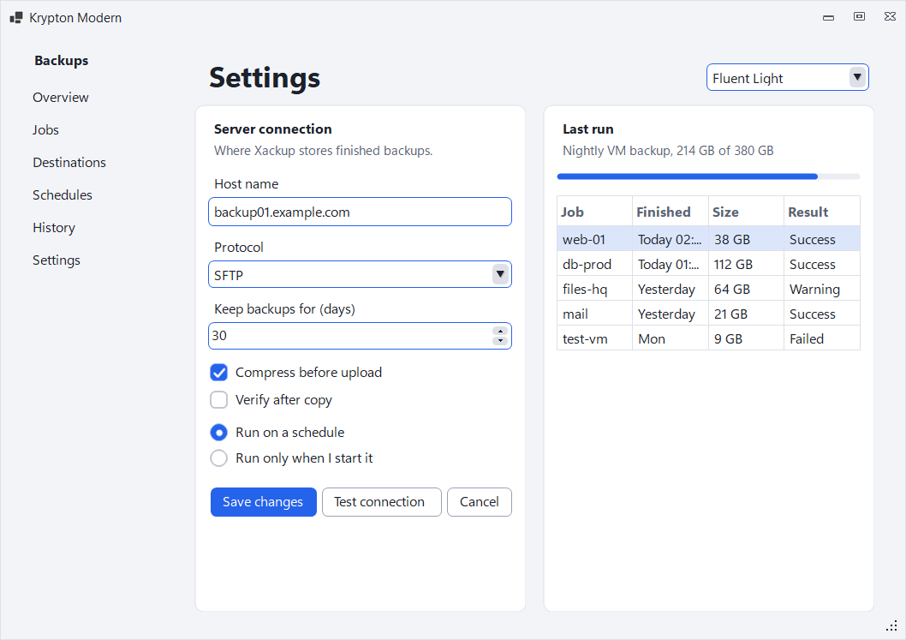
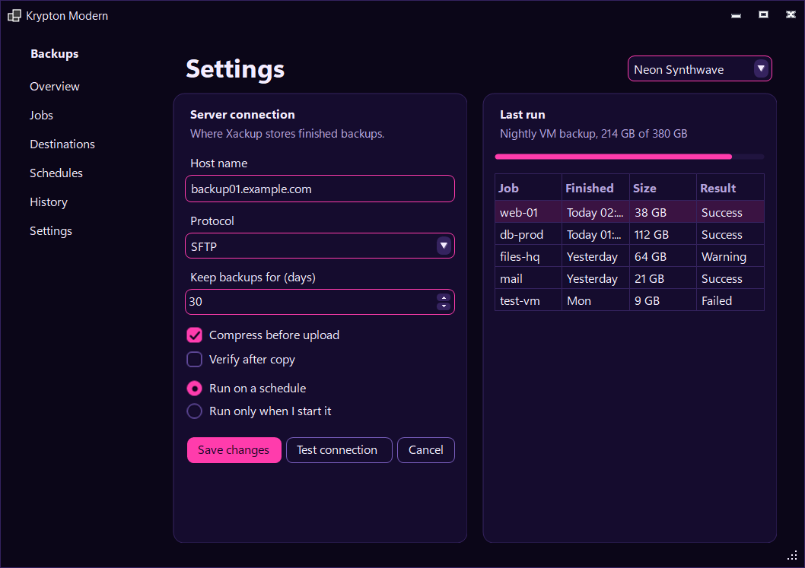
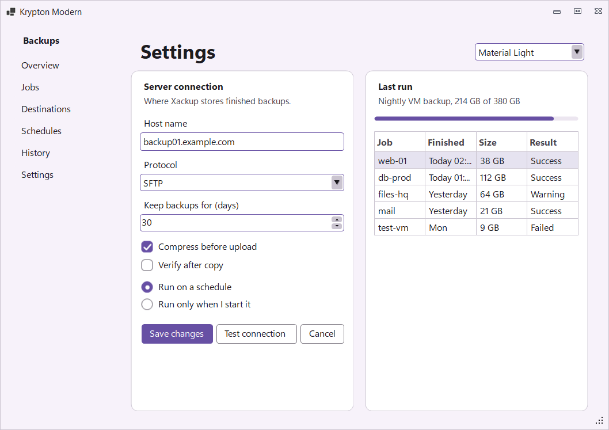
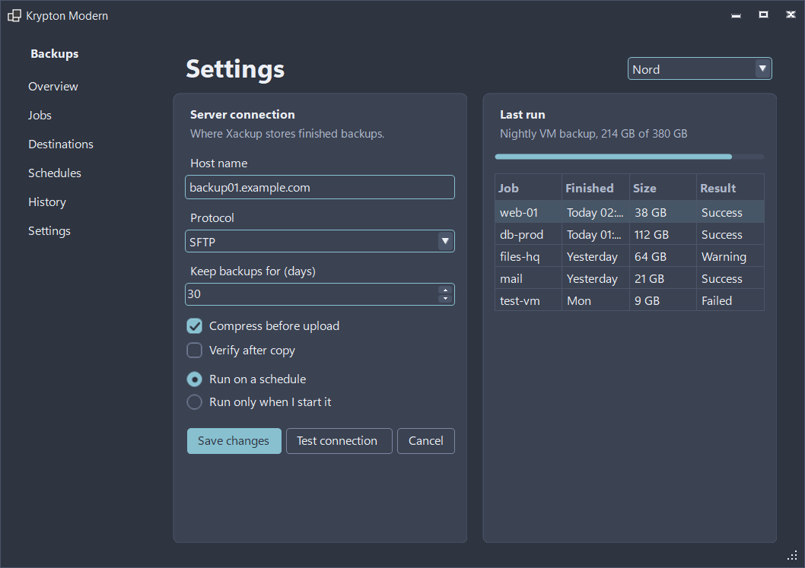
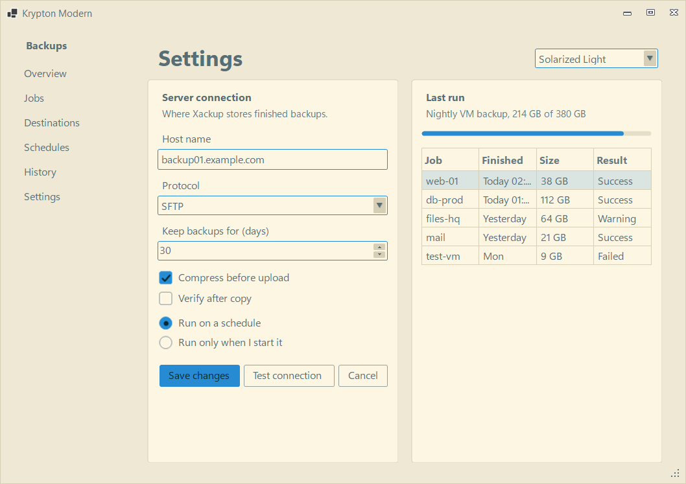
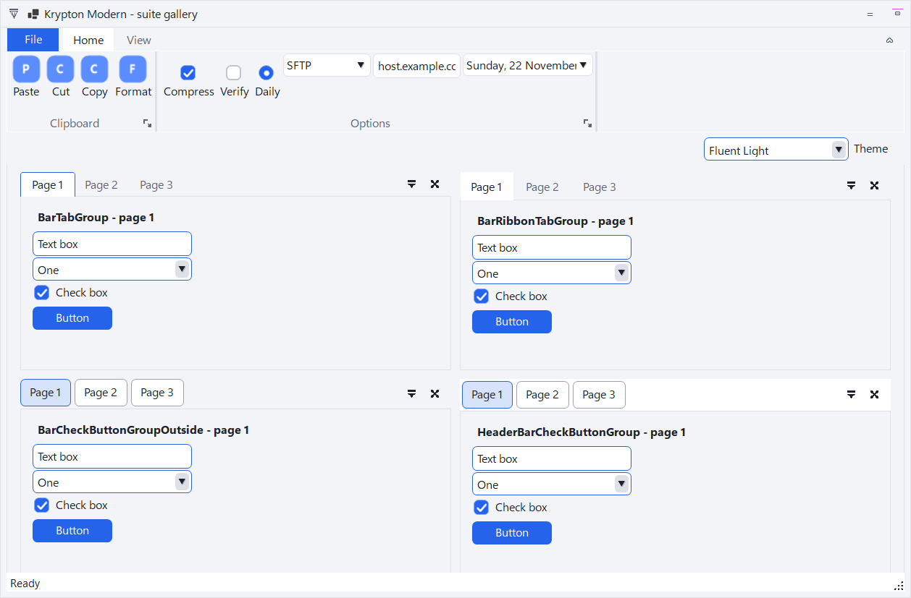
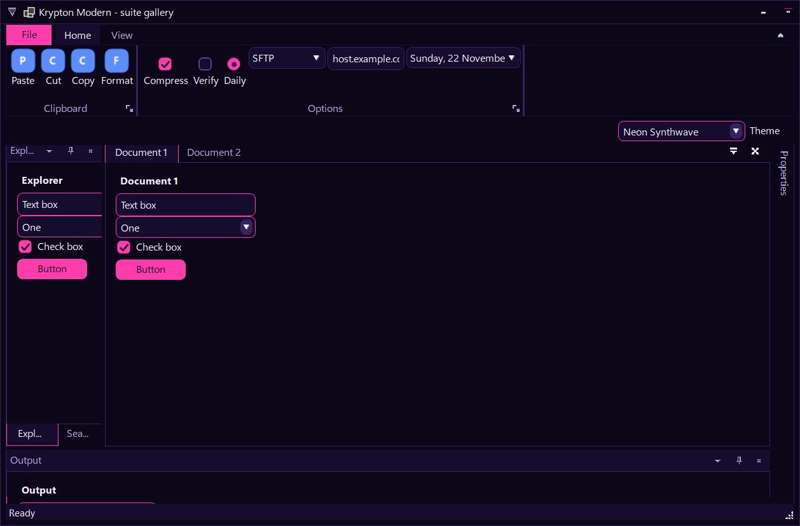

# KryptonModern

By **Fungusware**. Modern, flat themes for [Krypton Toolkit](https://github.com/Krypton-Suite/Standard-Toolkit) (WinForms).
Windows 11 / modern-web look: flat fills, hairline borders, rounded corners, one accent colour,
drawn check and radio glyphs, matching dark title bar. Ten themes included, and a theme is just
twelve colours, so adding your own takes a minute.

| Fluent Light | Fluent Dark | Neon Synthwave |
|---|---|---|
|  |  |  |

| Material Light | Material Dark | Nord |
|---|---|---|
|  |  |  |

| Solarized Light | Solarized Dark | Dracula |
|---|---|---|
|  |  |  |

The tenth theme, **Bezier**, imitates the DevExpress skin of the same name (cool grey canvas, white surfaces, tight corners, steel-blue accent). It is an approximation, tuned by eye.

## Krypton Studio: a Visual Studio clone

A full IDE built from Krypton controls and these themes, to show what the library can do: docking (Solution Explorer, Properties, Error List, Output, Find Results, Git Changes, auto-hide Toolbox, PowerShell), workspace tabs, a project tree that reads .sln / .slnx / .csproj, real `dotnet build` and run with errors shown as squiggles, live git status, Ctrl+Q command search, and a theme switch in View > Theme.

| Bezier | Dracula |
|---|---|
|  |  |

Open it from the launcher, or set `KM_FORM=4`. It opens this repository's own solution, and builds go to a temp folder so it can rebuild itself while running. The window is in `VsClone/`. The code editor is its own project, [`KryptonModern.Editor`](KryptonModern.Editor/README.md), with no Krypton dependency.

## Requirements

- Windows, .NET 8 (`net8.0-windows`) or newer
- NuGet package `Krypton.Toolkit` (the demo uses `105.26.7.201`)
- Optional, only if you use them: `Krypton.Navigator`, `Krypton.Ribbon`, `Krypton.Docking`, `Krypton.Workspace` (same version)

## Quick start

1. Add the Krypton Toolkit package to your WinForms project:

   ```
   dotnet add package Krypton.Toolkit
   ```

2. Copy these four files into your project (they have no other dependencies):

   | File | What it is |
   |---|---|
   | `ModernTheme.cs` | The colour tokens, the nine themes, and `ModernTheme.Build()` which makes the Krypton palette |
   | `ThemeApplier.cs` | Themes the controls a palette cannot reach: menus, toolbars, list views, tabs, group boxes, scrollbars, drop-down lists |
   | `ModernControls.cs` | `CardPanel` (rounded card) and `PillProgress` (thin progress bar) |

3. Make your main window a `KryptonForm` and apply a theme:

   ```csharp
   using Krypton.Toolkit;
   using KryptonModern;

   public partial class MainForm : KryptonForm
   {
       readonly KryptonManager _manager = new();
       KryptonCustomPaletteBase _palette;

       public MainForm()
       {
           InitializeComponent();
           // ThemeApplier walks the form's controls, which only exist once it is shown
           Shown += (_, _) => ApplyTheme(ModernTheme.NeonSynthwave);
       }

       void ApplyTheme(Tokens t)
       {
           var old = _palette;
           _palette = ModernTheme.Build(t);                 // 1. build the palette
           _manager.GlobalPaletteMode = PaletteMode.Custom; // 2. make it the global palette
           _manager.GlobalCustomPalette = _palette;
           old?.Dispose();

           BackColor = t.Canvas;
           ThemeApplier.Apply(this, t);                     // 3. theme the plain WinForms controls
       }
   }
   ```

   Step 3 re-walks the form, so call it again whenever the user switches theme.

## Control styles

Pick a style per control to get the roles used in the screenshots:

| Control | Property | Result |
|---|---|---|
| `KryptonButton` | `ButtonStyle = ButtonStyle.Custom1` | Primary button (accent fill) |
| `KryptonButton` | `ButtonStyle = ButtonStyle.Standalone` | Secondary button (outlined) |
| `KryptonButton` | `ButtonStyle = ButtonStyle.Custom2` | Subtle / navigation button (transparent until hovered) |
| `KryptonLabel` | `LabelStyle = LabelStyle.Custom1` | Muted caption |
| `KryptonLabel` | `LabelStyle = LabelStyle.TitlePanel` / `BoldPanel` | Page title / section heading |
| `KryptonPanel` | `PanelBackStyle = PaletteBackStyle.PanelCustom2` | Side navigation background |
| `CardPanel` | (add it to your layout) | Rounded, bordered surface |

Everything else (text boxes, combo boxes, numeric up-downs, check boxes, radio buttons, data grids,
list boxes, headers, splitters) picks the theme up from the palette with no extra work.

## Create your own theme

A theme is a `Tokens` record. Copy one of the themes in `ModernTheme.cs` and change the colours:

```csharp
public static readonly Tokens MyTheme = T("My Theme", radius: 6, card: 10,
    canvas:   0x101418,  // window background
    surface:  0x1A2026,  // cards and inputs
    alt:      0x252C34,  // hover and subtle fills
    border:   0x2F3842,  // hairlines
    strong:   0x6B7886,  // input and checkbox borders
    text:     0xEEF2F6,
    muted:    0x9AA7B4,  // secondary text
    accent:   0x4CC2FF,
    hover:    0x7AD3FF,
    pressed:  0x2FA9E8,
    onAccent: 0x06202E,  // text on top of the accent colour
    disabled: 0x5A6674);
```

Add it to the `All` array if you want it in the demo's theme picker. Keep text contrast at 4.5:1 or
better against `surface`, and `onAccent` readable against `accent`.

## Gotchas

- **Switch themes after a drop-down has closed.** Changing the palette (and its fonts) from inside a
  `SelectedIndexChanged` handler while a Krypton combo box is still open can crash the app with an
  `AccessViolationException`. If you change theme from a combo box, apply it after
  `DropDownClosed` / via `BeginInvoke`, as `DemoForm.cs` does.
- **Call `ThemeApplier.Apply` after the form is shown** (the `Shown` event), not in the constructor: in a `KryptonForm` the child controls are not reachable yet, so nothing gets themed and focused primary buttons look disabled.
- **Use `KryptonForm`** for the window, otherwise you keep the standard Windows title bar.
- **Drop-down list colours** are set per combo box. `ThemeApplier.Apply` does this for every
  `KryptonComboBox` it finds; call it again after you add controls at runtime.
- Plain `ProgressBar`, `DateTimePicker` and `TabControl` cannot be recoloured, so `ThemeApplier`
  swaps them for themed equivalents when it walks the form.

## Run the demo

```
git clone https://github.com/Fungusware/KryptonModern
cd KryptonModern
dotnet run
```

`dotnet run` opens a launcher where you pick one of three test windows (closing a window returns to the launcher). To skip the launcher, set the `KM_FORM` environment variable:

| `KM_FORM` | Window | Shows |
|---|---|---|
| `1` | Settings demo | A realistic settings page with a theme picker |
| `2` | Control check | Every Krypton Toolkit control and the plain WinForms controls side by side |
| `3` | Suite gallery | Ribbon, Navigator (tab / ribbon / check-button / header modes and Outlook stack), Workspace, Docking (dock, auto-hide, float) |`n| `4` | Krypton Studio | The Visual Studio clone described above |
| `4` | Krypton Studio | The Visual Studio clone described above |

```
set KM_FORM=3 && dotnet run         (cmd)
$env:KM_FORM=3; dotnet run          (PowerShell)
```

Each window has a theme picker; the gallery's four tabs cover the whole suite.





## Known limitations

- The Navigator `OutlookFull` stack buttons keep a thin light outline in dark themes.
- The window-caption icon is the default Krypton one unless you set `Icon` on your form.
- Ribbon item icons in the gallery are generated placeholders; supply your own images.

## Files

- `ModernTheme.cs` – tokens, themes, palette builder
- `ModernTheme.Suite.cs` – Navigator / Workspace / Docking / Ribbon / tool strip palette entries
- `ThemeApplier.cs` – theming for controls outside the palette
- `ModernControls.cs` – `CardPanel`, `PillProgress`
- `LauncherForm.cs`, `DemoForm.cs`, `ControlsForm.cs`, `GalleryForm.cs`, `Program.cs` – demo only, not needed in your project

## License

Copyright (c) 2026 Fungusware. Released under the [MIT license](LICENSE).
