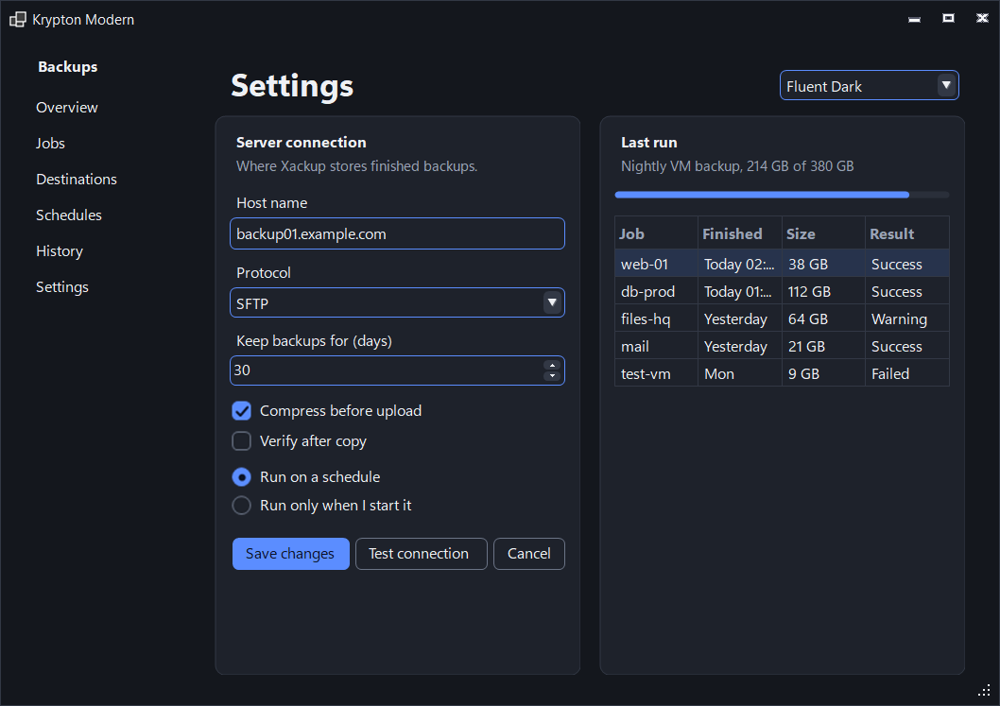
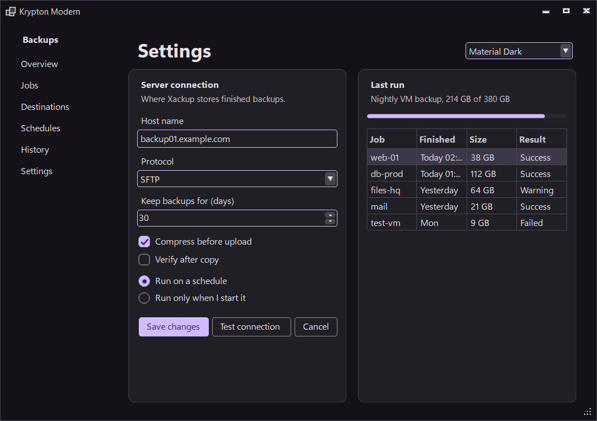
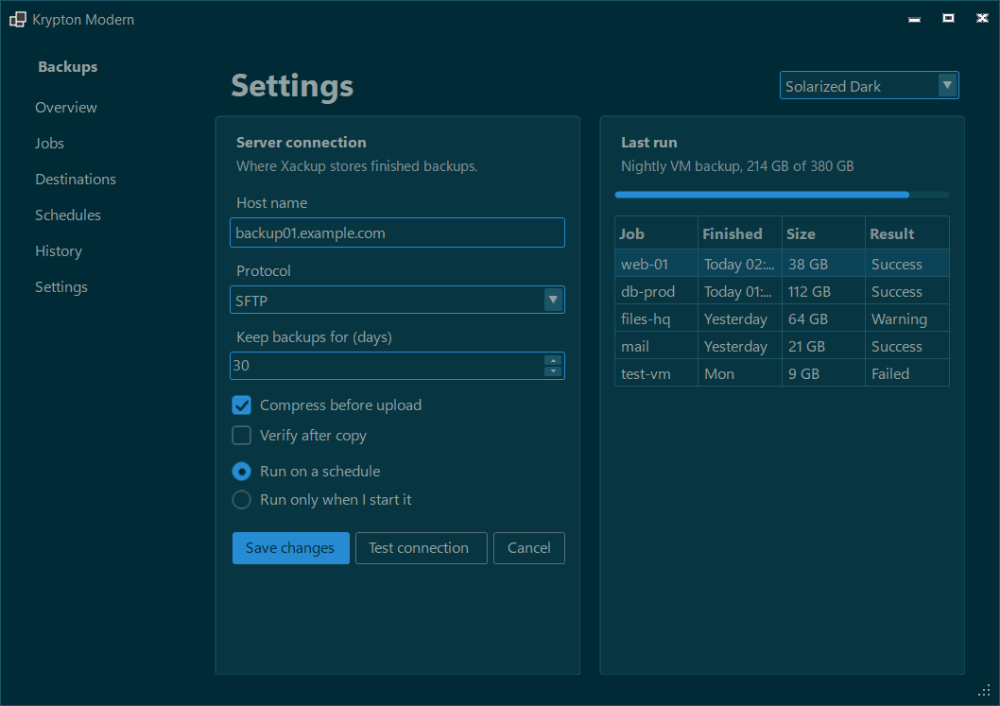
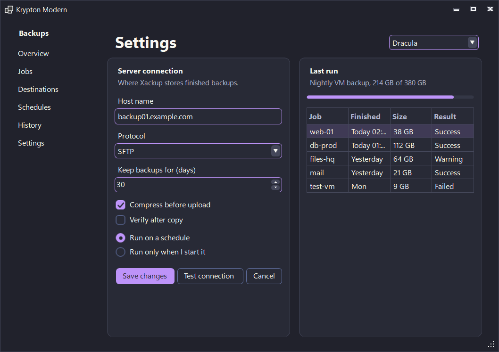
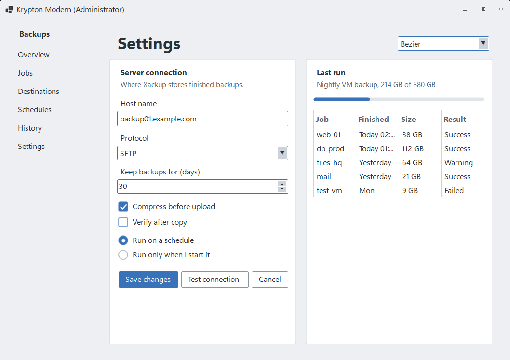
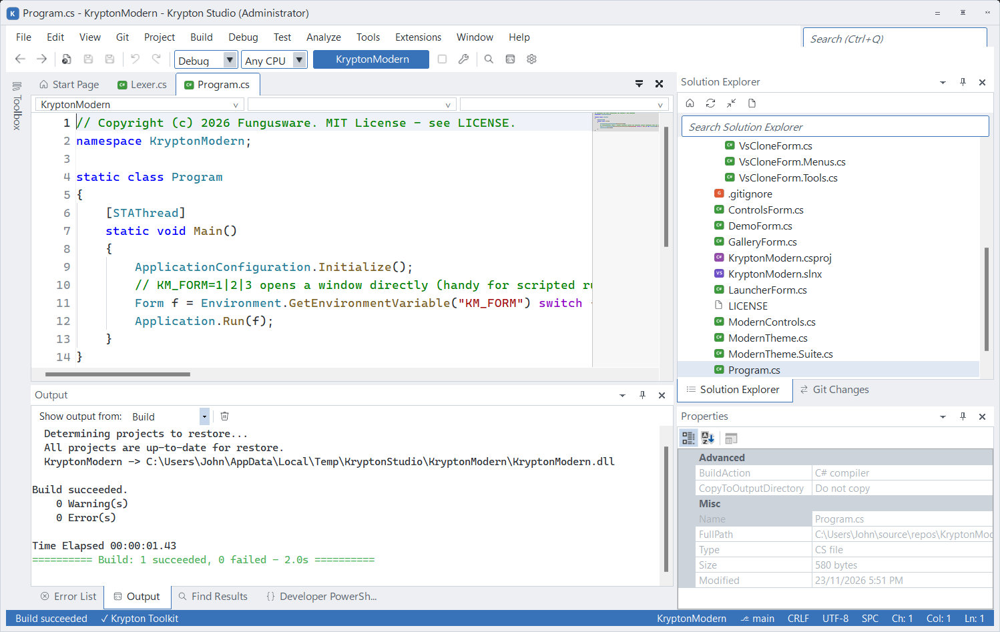
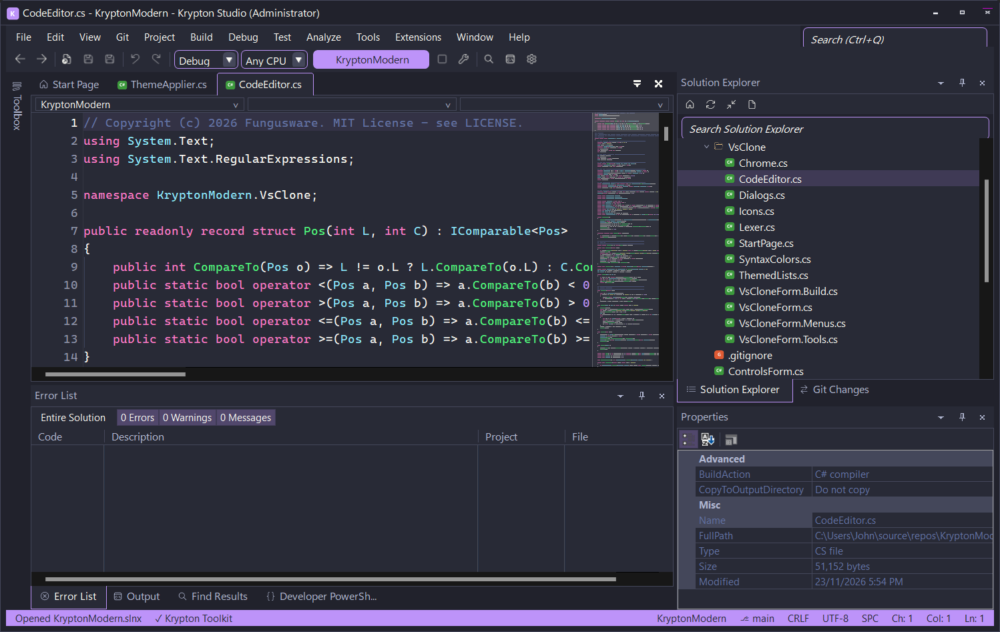
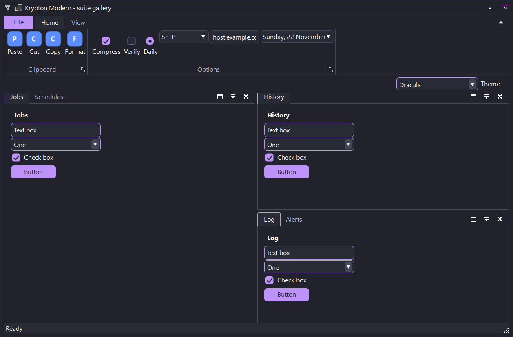

# Fungusware.WinFormsThemes

By **Fungusware**. Themes for WinForms apps, with adapters for [Krypton Toolkit](https://github.com/Krypton-Suite/Standard-Toolkit), ObjectListView and more.
Windows 11 / modern-web look: flat fills, hairline borders, rounded corners, one accent colour,
drawn check and radio glyphs, matching dark title bar. Ten themes included, and a theme is just
twelve colours, so adding your own takes a minute.

| Fluent Light | Fluent Dark | Neon Synthwave |
|---|---|---|
|  |  |  |

| Material Light | Material Dark | Nord |
|---|---|---|
|  |  |  |

| Solarized Light | Solarized Dark | Dracula |
|---|---|---|
|  |  |  |

The tenth theme, **Bezier**, imitates the DevExpress skin of the same name (cool grey canvas, white surfaces, tight corners, steel-blue accent). It is an approximation, tuned by eye.



## Krypton Studio: a Visual Studio clone

A full IDE built from Krypton controls and these themes, to show what the library can do: docking (Solution Explorer, Properties, Error List, Output, Find Results, Git Changes, auto-hide Toolbox, PowerShell), workspace tabs, a project tree that reads .sln / .slnx / .csproj, real `dotnet build` and run with errors shown as squiggles, live git status, Ctrl+Q command search, and a theme switch in View > Theme.

| Bezier | Dracula |
|---|---|
|  |  |

Open it from the launcher, or set `KM_FORM=4`. It opens this repository's own solution, and builds go to a temp folder so it can rebuild itself while running. The window is in `VsClone/`. The code editor is its own project, [`Fungusware.WinFormsThemes.Editor`](Fungusware.WinFormsThemes.Editor/README.md), with no Krypton dependency.

## Documentation

| Page | Read it for |
|---|---|
| [How it works](docs/how-it-works.md) | **Start here.** The idea, the packages, what happens at start-up, when a form opens and when the theme changes |
| [Getting started](docs/getting-started.md) | Copy-paste setup for plain WinForms, Krypton, ObjectListView; theme picker, saving the choice, custom controls, troubleshooting |
| [Adapters](docs/adapters.md) | What the Krypton and ObjectListView packages do, and how to write your own |
| [Themes and tokens](docs/themes-and-tokens.md) | The 12 colours, the ten themes, making your own, status colours, themed controls |
| [Migrating](docs/migrating-from-kryptonmodern.md) | Old names to new names |

## Packages

The theme is the master. `Fungusware.WinFormsThemes` holds the tokens, themes and the engine; the other packages are adapters that carry the active theme to a control family. Install only what you use.

| Package | What it does | Depends on |
|---|---|---|
| `Fungusware.WinFormsThemes` | Colour tokens, ten themes, the theme engine (saved theme, switch at run time, restyles plain WinForms controls as forms open), flat menu/toolbar renderer, status colours, `CardPanel`, `PillProgress`, `ModernTabControl` | nothing |
| `Fungusware.WinFormsThemes.Krypton` | Builds the Krypton palette from the active theme (forms, buttons, inputs, grid, Navigator, Ribbon, Docking) and styles Krypton controls | the core, `Krypton.*` |
| `Fungusware.WinFormsThemes.ObjectListView` | Themed ObjectListView headers, selection, empty-list message and column sizing | the core, `ObjectListView.Repack.NET6Plus` |
| `Fungusware.WinFormsThemes.Editor` | A fast code editor control with syntax highlighting, minimap and completion ([readme](Fungusware.WinFormsThemes.Editor/README.md)) | nothing |

## Requirements

- Windows, .NET 8 (`net8.0-windows`) or newer
- For the Krypton adapter: `Krypton.Toolkit` (the demo uses `105.26.7.201`), and optionally `Krypton.Navigator`, `Krypton.Ribbon`, `Krypton.Docking`, `Krypton.Workspace` (same version)

## Quick start

```
dotnet add package Fungusware.WinFormsThemes
dotnet add package Fungusware.WinFormsThemes.Krypton       # if you use Krypton
dotnet add package Fungusware.WinFormsThemes.ObjectListView # if you use ObjectListView
```

Register the adapters you use, then install the engine once, before the first form is created:

```csharp
using Fungusware.WinFormsThemes;

static void Main()
{
    ApplicationConfiguration.Initialize();
    KryptonTheme.Register();           // Krypton follows the theme
    ObjectListViewTheme.Register();    // ObjectListView follows the theme
    ThemeApplier.Install(ModernTheme.NeonSynthwave);
    Application.Run(new MainForm());   // forms are themed as they open
}
```

Switch theme at run time with `ThemeApplier.SetTheme(ModernTheme.FluentDark)` (every open form and every adapter follows), or add a ready-made menu with `ThemeApplier.AddThemeMenu(menuItem)`. `ThemeApplier.ReadSavedThemeName` / `WriteSavedThemeName` let the app store the choice. Use `ThemeApplier.RegisterStyler<T>` for your own controls and `ThemeApplier.RegisterAdapter` to add another control family.

Apps that want to manage the Krypton palette themselves can skip `Install` and use `KryptonTheme.Build(tokens)` with `ThemeApplier.Apply(form, tokens)`, as the demo does.

## Control styles

Pick a style per control to get the roles used in the screenshots:

| Control | Property | Result |
|---|---|---|
| `KryptonButton` | `ButtonStyle = ButtonStyle.Custom1` | Primary button (accent fill) |
| `KryptonButton` | `ButtonStyle = ButtonStyle.Standalone` | Secondary button (outlined) |
| `KryptonButton` | `ButtonStyle = ButtonStyle.Custom2` | Subtle / navigation button (transparent until hovered) |
| `KryptonLabel` | `LabelStyle = LabelStyle.Custom1` | Muted caption |
| `KryptonLabel` | `LabelStyle = LabelStyle.TitlePanel` / `BoldPanel` | Page title / section heading |
| `KryptonPanel` | `PanelBackStyle = PaletteBackStyle.PanelCustom2` | Side navigation background |
| `CardPanel` | (add it to your layout) | Rounded, bordered surface |

Everything else (text boxes, combo boxes, numeric up-downs, check boxes, radio buttons, data grids,
list boxes, headers, splitters) picks the theme up from the palette with no extra work.

## Create your own theme

A theme is a `Tokens` record of 12 colours. Copy an existing one and change the colours; the full recipe, with what each colour is for and how to pick them, is in [Themes and tokens](docs/themes-and-tokens.md#make-your-own-theme). Then `ThemeApplier.SetTheme(MyThemes.Forest)`.

## Gotchas

- **`KryptonMessageBox` under a custom palette.** It is built outside `ThemeApplier`'s reach, so its default button keeps the base palette's light fill and its text can look washed out in dark themes. The demo uses its own `KMessage` (in `VsClone/Dialogs.cs`), an ordinary `KryptonForm` that `ThemeApplier` walks, with the same `Show` signature.

- **Switch themes after a drop-down has closed.** Changing the palette (and its fonts) from inside a
  `SelectedIndexChanged` handler while a Krypton combo box is still open can crash the app with an
  `AccessViolationException`. If you change theme from a combo box, apply it after
  `DropDownClosed` / via `BeginInvoke`, as `DemoForm.cs` does.
- **If you call `ThemeApplier.Apply(form, tokens)` yourself (advanced), call it after the form is shown** (the `Shown` event), not in the constructor: in a `KryptonForm` the child controls are not reachable yet, so nothing gets themed and focused primary buttons look disabled.
- **Use `KryptonForm`** for the window, otherwise you keep the standard Windows title bar.
- **Drop-down list colours** are set per combo box. The engine does this for every
  `KryptonComboBox` it finds; call it again after you add controls at runtime.

## Run the demo

```
git clone https://github.com/Fungusware/Fungusware.WinFormsThemes
cd Fungusware.WinFormsThemes
dotnet run
```

`dotnet run` opens a launcher where you pick one of three test windows (closing a window returns to the launcher). To skip the launcher, set the `KM_FORM` environment variable:

| `KM_FORM` | Window | Shows |
|---|---|---|
| `1` | Settings demo | A realistic settings page with a theme picker |
| `2` | Control check | Every Krypton Toolkit control and the plain WinForms controls side by side |
| `3` | Suite gallery | Ribbon, Navigator (tab / ribbon / check-button / header modes and Outlook stack), Workspace, Docking (dock, auto-hide, float) |`n| `4` | Krypton Studio | The Visual Studio clone described above |
| `4` | Krypton Studio | The Visual Studio clone described above |

```
set KM_FORM=3 && dotnet run         (cmd)
$env:KM_FORM=3; dotnet run          (PowerShell)
```

Each window has a theme picker; the gallery's four tabs cover the whole suite.




## Known limitations

- The Navigator `OutlookFull` stack buttons keep a thin light outline in dark themes.
- The window-caption icon is the default Krypton one unless you set `Icon` on your form.
- Ribbon item icons in the gallery are generated placeholders; supply your own images.

## Files

- `Fungusware.WinFormsThemes/` – `ModernTheme.cs` (tokens and themes), `ThemeApplier.cs` (the engine), `ThemeAdapter.cs` (the adapter base), `StatusColors.cs`, `ModernControls.cs`
- `Fungusware.WinFormsThemes.Krypton/` – `KryptonTheme.cs` (adapter), `KryptonTheme.Palette.cs` (palette builder), `KryptonTheme.Suite.cs` (Navigator / Workspace / Docking / Ribbon / tool strip entries)
- `Fungusware.WinFormsThemes.ObjectListView/` – `ObjectListViewTheme.cs`
- `Fungusware.WinFormsThemes.Editor/` – the code editor control
- `Fungusware.WinFormsThemes.Demo.csproj` and the `.cs` files beside it (`LauncherForm`, `DemoForm`, `ControlsForm`, `GalleryForm`, `VsClone/`) – demo only

## License

Copyright (c) 2026 Fungusware. Released under the [MIT license](LICENSE).
