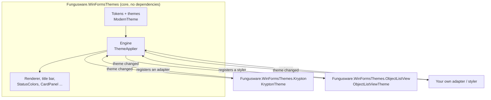
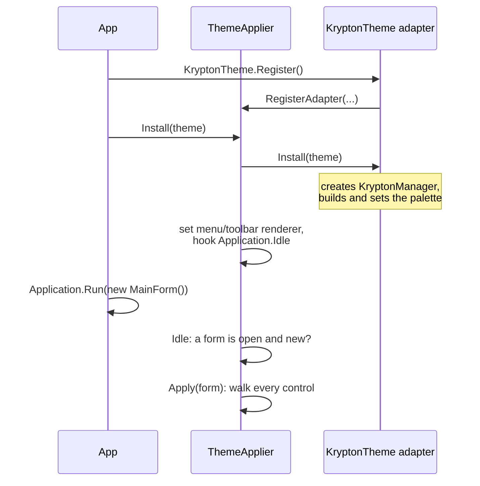
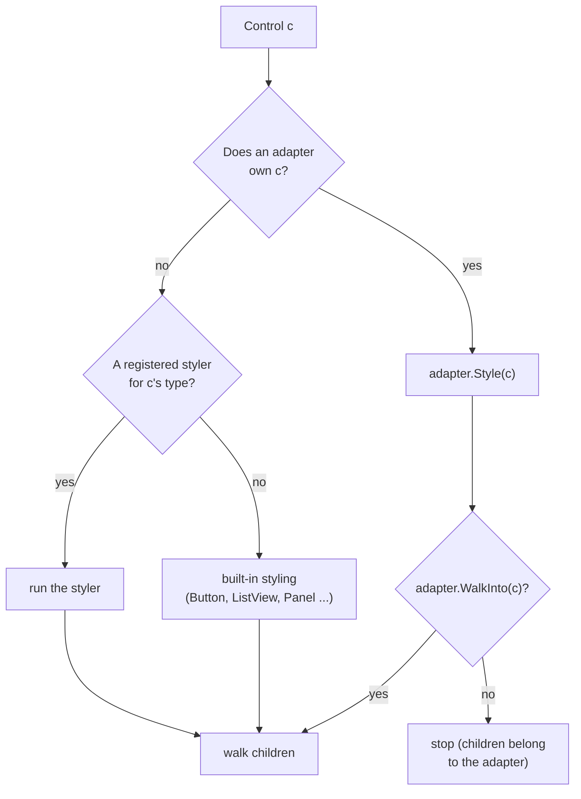

# How it works

Read this first. It explains the idea, the pieces, and what happens when a form opens or the theme changes.

## The idea in one paragraph

A **theme** is just a set of colours (a `Tokens` record). The **core package** owns the themes and one **engine** (`ThemeApplier`). The engine knows which theme is active and restyles every form and control as it opens. Different kinds of control need different handling, so the engine hands some of them to an **adapter**: a small class that knows one control family (Krypton, ObjectListView, a code editor). The core never depends on any of those libraries. The adapters depend on the core, never the other way round.

The theme is the master: you pick a theme in one place (`ThemeApplier.SetTheme`), and every adapter is told.

## The four packages

| Package | Role | Depends on |
|---|---|---|
| `Fungusware.WinFormsThemes` | Themes, engine, plain WinForms styling, menu and toolbar renderer, status colours, a few themed controls | Nothing |
| `Fungusware.WinFormsThemes.Krypton` | Adapter. Builds the Krypton palette from the active theme and styles Krypton controls | Core, `Krypton.*` |
| `Fungusware.WinFormsThemes.ObjectListView` | Adapter. Styles ObjectListView headers, selection and empty-list text | Core, `ObjectListView.Repack.NET6Plus` |
| `Fungusware.WinFormsThemes.Editor` | A code editor control. Standalone for now; it has its own theme class, and the demo shows how to feed it from a theme | Nothing |

You install the core plus only the adapters for libraries you actually use.

## What each piece does

### `Tokens` and `ModernTheme` (the colours)

`Tokens` is a record of 12 colours plus a name and two corner radii: `Canvas` (window background), `Surface` (inputs, lists, cards), `SurfaceAlt`, `Border`, `BorderStrong`, `Text`, `TextMuted`, `Accent`, `AccentHover`, `AccentPressed`, `OnAccent`, `Disabled`.

`ModernTheme` holds the ready-made themes (`FluentLight`, `FluentDark`, `MaterialLight`, `MaterialDark`, `SolarizedLight`, `SolarizedDark`, `Nord`, `Dracula`, `NeonSynthwave`, `Bezier`), the list `ModernTheme.All`, and helpers (`IsDark`, `Blend`, `Chrome`). See [themes-and-tokens.md](themes-and-tokens.md).

### `ThemeApplier` (the engine)

One static class. It keeps the current theme (`ThemeApplier.Current`), restyles forms, and tells the adapters about changes. It has three jobs:

1. **Install** once at start-up (`ThemeApplier.Install`).
2. **Theme every form** as it opens, and every control added later.
3. **Switch** theme at run time (`ThemeApplier.SetTheme`).

### Adapters

An adapter is a class derived from `ThemeAdapter`. It answers four questions for the engine:

| Method | Question |
|---|---|
| `Install(tokens)` | The engine is starting with this theme: set up whatever you need. |
| `ThemeChanged(tokens)` | The theme just switched: update yourself. |
| `Owns(control)` | Is this control one of yours? If yes, the engine leaves it to you. |
| `Style(control, tokens)` / `WalkInto(control)` | Style it. Should the engine look at the controls inside it? |

The Krypton adapter is the real example. See [adapters.md](adapters.md).

### Stylers and refreshers (the lightweight alternative)

If you only need to style one control type, you do not need a whole adapter:

- `ThemeApplier.RegisterStyler<T>(Action<T, Tokens>)`: "when you see a `T`, call this instead of the built-in styling". It runs again on every theme change. The ObjectListView package uses this.
- `ThemeApplier.RegisterRefresh<T>(Action<T>)`: "after a theme switch, call this for every `T`". For controls whose row or cell colours are chosen when the data is built, so they can rebuild them.

## What happens at start-up

Order rule: **register adapters, then install**. If you register an adapter after `Install`, it is installed immediately, so either order works, but registering first avoids one frame of the wrong look.

## What happens when a form opens

The engine hooks `Application.Idle`. On the first idle after a form opens (modal dialogs included), it calls `Apply(form)`, which **walks the control tree** once and restyles each control **in place**. Nothing is replaced or recreated, so designer fields and event handlers keep working.

For each control the walk does this:

Controls added to a form later are picked up through the `ControlAdded` event, so you do not need to call anything.

## What happens when the theme changes

`ThemeApplier.SetTheme(tokens)`:

1. Stores the new theme as `Current`.
2. Asks Windows for dark or light native scroll bars and menus.
3. Calls `ThemeChanged(tokens)` on every adapter (Krypton rebuilds its palette here).
4. Installs a new menu and toolbar renderer.
5. Restyles every open form, then runs the registered refreshers (ObjectListView rebuilds its rows).
6. Saves the theme name through your `WriteSavedThemeName` hook.
7. Raises `ThemeApplier.ThemeChanged`.

Calling `SetTheme` with the theme that is already active does nothing.

## What the engine styles by itself (plain WinForms)

| Control | What changes |
|---|---|
| `Form` | Background and text colour, and on Windows 11 the title bar colour and dark mode |
| `SplitContainer`, `Panel`, `FlowLayoutPanel`, `TableLayoutPanel`, `UserControl` | Transparent or canvas background so the theme shows through |
| `ToolStrip`, `MenuStrip`, `StatusStrip` | Flat renderer with a soft hover highlight, plus a little padding on toolbar buttons |
| `TabControl`, `TabPage` | Owner-drawn flat tabs with an accent underline |
| `ListView` | Owner-drawn flat header, accent-tinted selection, last column fills the width |
| `GroupBox` | Rounded hairline outline |
| `Button` | Flat, themed border and hover colours |
| `TextBox`, `ComboBox`, `NumericUpDown`, `RichTextBox`, `ListBox`, `TreeView` | Surface and text colours, dark scroll bars |
| `CheckBox`, `RadioButton`, `Label` | Text colour, transparent background |
| `ProgressBar` | Accent fill |
| `PropertyGrid` | All its colours |

Windows draws a few things itself, so the engine asks Windows for the dark variant of scroll bars and context menus. That relies on undocumented uxtheme calls (Windows 10 1903 and later). If they fail, those parts simply stay light.

## Where Krypton fits

Krypton draws its own controls from a **palette**, not from the properties the engine sets on plain controls. So the Krypton adapter does two things:

1. **Palette:** `KryptonTheme.Build(tokens)` turns a `Tokens` into a `KryptonCustomPaletteBase` (form, panels, labels, buttons, inputs, grid, check boxes, Navigator, Ribbon, Docking...). The adapter assigns it to `KryptonManager.GlobalCustomPalette`, and again on every theme change.
2. **A few control tweaks** that a palette cannot do: inputs stop showing the accent colour all the time (`AlwaysActive = false`), bottom bars get the chrome tone, link labels get the accent.

A Krypton control is "owned" by the adapter (anything in the `Krypton.Toolkit` namespace), so the engine's own styling skips it. Inside a Krypton panel, form, split container or group box the engine keeps walking, because plain controls can sit in there. Inside a Krypton text box or combo it stops, because those parts belong to the palette.

## Rules of thumb

- **Install once, early.** `Install` before the first form is created.
- **Never theme by hand.** No per-form `ApplyTheme()` calls; the engine does it on open and on switch.
- **Style the data, not the control.** If a list colours rows in a formatter, read the colours from `ThemeApplier.Current` or `StatusColors`, and register a refresher so rows rebuild on a switch.
- **A new control family gets an adapter**, not changes to the core.
